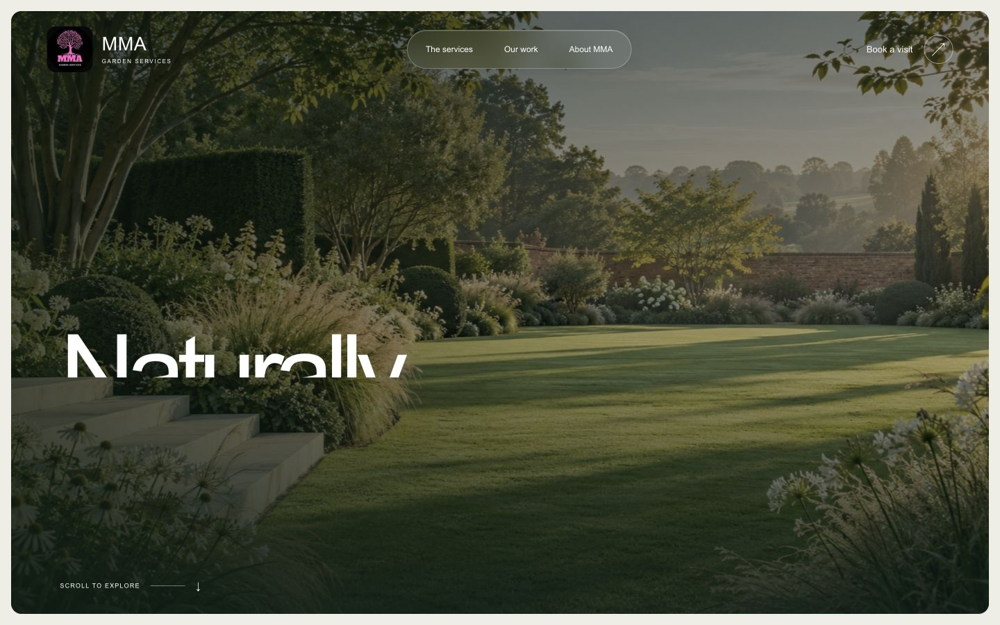

# MMA Garden Studio

An original, responsive website and booking-workspace proposal for **MMA Garden Services, Leicester & Leicestershire**.

Built by Kamil as a client pitch and portfolio project. This project has not been commissioned or endorsed by MMA. The company’s existing logo and project photographs are used in this proposal at the user’s request; those assets remain the rights holders’ property. The opening garden image is an AI-generated visual study.

## The experience

- Editorial garden website with glass navigation, responsive layouts and reduced-motion support.
- Twelve marketing/proposal URLs with their own 1200×630 sharing cards.
- Four verified before-and-after photo pairs, a keyboard-operable comparison slider and a project selector.
- Visit requests with preferred UK date/time windows, garden details and up to three private photos.
- Supabase email sign-in, server-side owner/team authorisation, booking review and assignment.
- Draft/publish website copy, price labels, revision history and controlled restoration.
- Availability exceptions and protection against accepting two visits in one window.
- A client proposal: £1,950 one-time build; optional £95/month care. Hosting and paid services separate.



## Stack

**Next.js 16 · React 19 · TypeScript · shadcn/ui · Supabase Auth, Postgres, Storage & Edge Functions · Vercel**

The public site is rendered on the server. Private database access runs in the Supabase Edge Function using its built-in server credential. The service key is never copied to Vercel, browser code or this repository. Public tables have RLS enabled and direct anonymous/authenticated access revoked. Each CMS request validates the user and role on the server.

## Run locally

Use Node 24 and pnpm 11.25.0.

```sh
pnpm install --frozen-lockfile
cp .env.example .env.local
# Fill in the public Supabase URL, publishable key and local site URL.
pnpm run dev
```

The database and Edge Function must be provisioned before the booking and CMS flows work. Without configuration the marketing pages remain visible, while booking/data endpoints fail closed with an explicit setup message.

```sh
pnpm run typecheck
pnpm run build
```

## Deployment

See [deployment notes](docs/deployment.md), [the client proposal](docs/client-proposal.md), and [the asset provenance](docs/mma-assets.md), and [verification results](docs/verification.md). Vercel builds from this GitHub repository. Configure public Supabase variables using Vercel’s environment settings; never commit `.env.local`, tokens or credentials.

The app stays in **test-booking mode** until business approval, privacy arrangements, operational availability and contact/notification settings are confirmed. A request is not a confirmed appointment. This preview does not send booking emails or take payment. Owner login emails are sent by Supabase only when a user requests one.

## Page map

`/` · `/services` · `/services/regular-maintenance` · `/services/garden-clearance` · `/services/hedges-trees-lawns` · `/projects` · `/about` · `/pricing` · `/booking` · `/contact` · `/privacy` · `/proposal`

Owner workspace: `/admin`.

## Prices and claims

No numeric MMA tariff was found on the checked official pages. Service prices remain “Request a quote”; the CMS supports owner-approved price labels. Other businesses’ prices are not attributed to MMA. Project locations, dates, durations and outcomes have not been invented. The preview remains `noindex` until the business approves publication.

## Learning and authorship

This repository records the actual implementation and verification work. It is an AI-assisted development project; generated code and design choices are reviewed and tested. Commit history is not backdated or inflated. Third-party libraries retain their licences, and third-party business media are not offered under an open-source licence.
